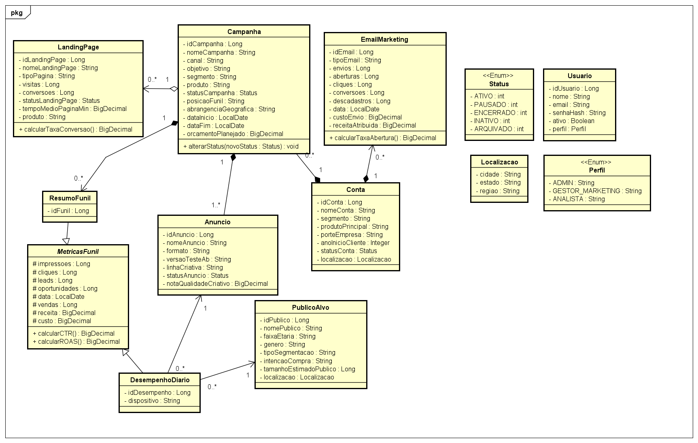
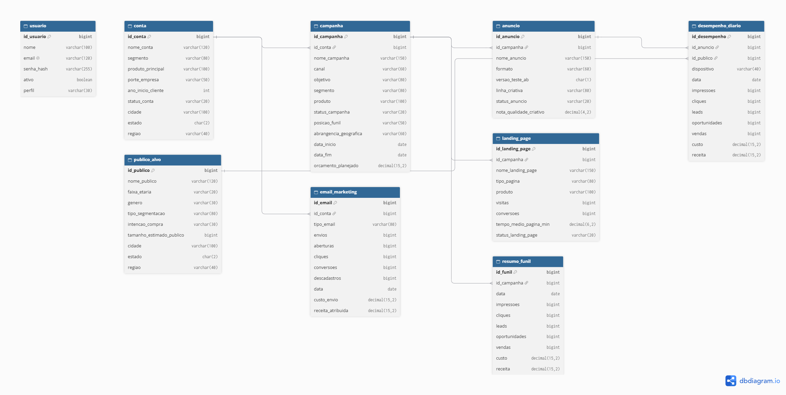
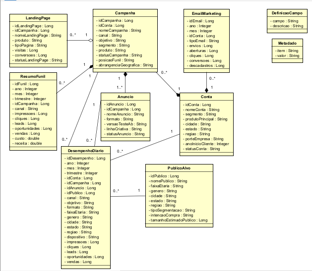

# Projeto Integrador Full Stack — Gestão e Análise de Marketing Digital

* **Instituição:** ESEG — Escola Superior de Engenharia e Gestão
* **Curso:** Engenharia de Computação — Programação Web (2º Semestre de 2026)
* **Estudante:** Eduardo Marques Fadini — RA: 42721
* **Status do Projeto:** 1ª Entrega (Fases 1–4) ✅ | 2ª Entrega (Fases 5–8) ✅ | 3ª Entrega (Fases 9–10) ✅ | 4ª Entrega (Fases 11–13) ✅

---

## 1. Visão Geral do Projeto

Aplicação web completa desenvolvida em **Java 21 com Spring Boot 3.3.5** para modernização de uma base de dados legada de marketing digital (`18_marketing_digital.xlsx`, contendo 31.314 registros distribuídos entre 2024 e 2025). 

O sistema elimina redundâncias e anomalias cadastrais através da normalização na **3ª Forma Normal (3FN)**, substitui colunas calculadas fixas por métodos de domínio dinâmicos de alta precisão com `BigDecimal`, padroniza o ciclo de vida das entidades via máquina de estados com o enum `Status`, implementa controle orçamentário em tempo real com persistência relacional física e protege todas as operações no servidor com autenticação e controle de acesso baseado em perfis (**RBAC**).

---

## 2. Tecnologias Utilizadas

* **Linguagem:** Java 21 LTS
* **Framework Backend:** Spring Boot 3.3.5 (`Spring Web / MVC`, `Spring Data JPA`, `Bean Validation`)
* **Segurança:** Spring Security 6 + `BCryptPasswordEncoder` + `thymeleaf-extras-springsecurity6` + `spring-security-test`
* **ORM / Persistência:** Hibernate 6 / Jakarta Persistence (JPA)
* **Banco de Dados Relacional:** H2 Database (persistência física em arquivo `./data/marketing_db;AUTO_SERVER=TRUE`) e suporte pronto a PostgreSQL
* **Frontend & Design System:** Thymeleaf + Bootstrap 5.3 + Bootstrap Icons 1.11 + Tipografia Google Fonts (*Plus Jakarta Sans*) + Paleta de Cores *Cyber Marketing* (Roxo & Amarelo)
* **Testes Automatizados:** JUnit 5, Spring Boot Test, MockMvc (13 testes automatizados — 100% aprovados)
* **Controle de Versão e Build:** Git & Apache Maven

---

## 3. Arquitetura e Organização do Projeto

O código-fonte segue a arquitetura em camadas no pacote base `br.edu.eseg.marketing`:

```text
meu-projeto-marketing/
├── docs/                                # Artefatos de modelagem, diagramas UML/DER e relatórios
│   ├── Relatorio_Tecnico_Entrega1.pdf
│   ├── diagrama-classes-uml.png
│   ├── modelo-relacional-der.png
│   ├── modelo-legado.png
│   ├── modelagem.asta                   # Arquivo fonte do Astah UML
│   └── modelagem.dbml                   # Código DBML do diagrama relacional
├── sql/
│   └── schema.sql                       # Script DDL ANSI oficial (CREATE TABLE, FKs, CHECKS, Índices)
├── src/
│   ├── main/
│   │   ├── java/br/edu/eseg/marketing/
│   │   │   ├── config/                  # DataInitializer, SecurityConfig e UsuarioDetailsService
│   │   │   ├── controller/              # Controllers MVC, AuthController e GlobalExceptionHandler
│   │   │   ├── domain/                  # Entidades JPA, @MappedSuperclass, @Embeddable e Enums
│   │   │   ├── exception/               # Exceções de regra de negócio e recursos não encontrados
│   │   │   ├── repository/              # Interfaces Spring Data JPA com consultas customizadas
│   │   │   ├── service/                 # Regras de negócio, transições de status e validações
│   │   │   └── MarketingDigitalApplication.java
│   │   └── resources/
│   │       ├── static/css/
│   │       │   └── custom.css           # Design System (Roxo Imperial, Violeta Tech e Amarelo Ouro)
│   │       ├── templates/               # Templates dinâmicos Thymeleaf + Bootstrap 5
│   │       │   ├── anuncios/            # Listagem e formulário de anúncios
│   │       │   ├── campanhas/           # Listagem, formulário e painel detalhado de campanha/funil
│   │       │   ├── contas/              # Listagem e formulário de contas anunciantes
│   │       │   ├── fragments/           # Navbar responsiva e Rodapé institucional (footer.html)
│   │       │   ├── acesso-negado.html   # Página HTTP 403 personalizada
│   │       │   ├── dashboard.html       # Painel analítico principal com KPIs modernos
│   │       │   ├── erro.html            # Página de tratamento de erros amigável
│   │       │   └── login.html           # Tela de autenticação estilo SaaS
│   │       ├── 18_marketing_digital.xlsx # Base de dados legada para migração automatizada
│   │       └── application.properties   # Configuração da unidade de persistência e servidor
│   └── test/java/br/edu/eseg/marketing/ # Suíte de 13 testes automatizados JUnit 5
│       ├── AnuncioServiceTest.java      # Testes de estouro de orçamento (RF05) e bloqueio
│       ├── CampanhaServiceTest.java     # Teste de proteção de exclusão de campanha ativa
│       ├── CampanhaTest.java            # Testes unitários da máquina de estados de Status
│       ├── MetricasFunilTest.java       # Testes de cálculo de CTR, divisão por zero e ROAS
│       └── SegurancaIntegracaoTest.java # Testes de integração MockMvc para RBAC e HTTP 403 (RF06)
├── pom.xml
└── README.md
```

---

## 4. Instruções de Instalação, Configuração e Execução

### 4.1. Pré-requisitos
* **JDK 21** instalado e configurado na variável de ambiente `JAVA_HOME`.
* **Maven 3.9+** (ou Maven embutido na IDE).

### 4.2. Executando a Aplicação
1. Clone o repositório:
   ```bash
   git clone https://github.com/SEU-USUARIO/projeto-integrador-marketing-digital.git
   cd projeto-integrador-marketing-digital
   ```
2. Inicie o servidor Spring Boot:
   ```bash
   mvn spring-boot:run
   ```
3. **Carga e Higienização Automática dos Dados (`DataInitializer`):**
   Na inicialização, o sistema processa a planilha `18_marketing_digital.xlsx` via parser XML/StAX de alta performance, corrigindo datas seriais, unificando status divergentes e persistindo os **31.314 registros reais** no banco físico local:
   * **40** Contas Anunciantes
   * **160** Campanhas
   * **560** Anúncios
   * **220** Públicos-Alvo
   * **120** Landing Pages
   * **1.473** Disparos de E-mail Marketing
   * **3.831** Resumos Mensais de Funil
   * **24.910** Registros de Desempenho Diário normalizados na 3FN
   * **3** Usuários padrão com senhas criptografadas em `BCrypt`

### 4.3. Executando os Testes Automatizados
Para rodar a suíte completa de 13 testes unitários e de integração:
```bash
mvn test
```
*Resultado esperado:* `Tests run: 13, Failures: 0, Errors: 0, Skipped: 0` &bull; **BUILD SUCCESS**.

---

## 5. Endereços de Acesso e Credenciais de Teste (RBAC)

* **Aplicação Web:** [http://localhost:8081/login](http://localhost:8081/login)
* **Console do Banco H2:** [http://localhost:8081/h2-console](http://localhost:8081/h2-console)  
  * **JDBC URL:** `jdbc:h2:file:./data/marketing_db`
  * **User Name:** `sa`
  * **Password:** *(deixar em branco)*

| Perfil (`Role`) | E-mail (Login) | Senha | Permissões no Sistema (Validadas no Servidor) |
| :--- | :--- | :--- | :--- |
| **`ADMIN`** | `admin@eseg.edu.br` | `admin123` | **Acesso Total:** Criação/edição de Contas, Campanhas, Anúncios e permissão exclusiva para exclusão física de registros. |
| **`GESTOR_MARKETING`** | `gestor@eseg.edu.br` | `gestor123` | **Gestão de Mídia:** Criação, edição e transição de status de Campanhas e Anúncios. Bloqueado de criar Contas ou excluir registros. |
| **`ANALISTA`** | `analista@eseg.edu.br` | `analista123` | **Somente Leitura:** Acesso aos dashboards, gráficos e listagens analíticas. Qualquer tentativa de requisição de escrita via POST/DELETE é bloqueada com **HTTP 403 Forbidden**. |

---

## 6. Identidade Visual e Design System (*Color Hunt*)

A interface foi reformulada com base na paleta **Cyber Marketing & Analytics**, unindo sofisticação, tecnologia e alta legibilidade:

* **Roxo Imperial (`#1A103C`):** Barra de navegação e tipografia institucional.
* **Violeta Tech (`#6C5CE7`):** Botões principais de ação, links e destaques visuais com efeito de elevação (*hover*).
* **Amarelo Ouro / Âmbar (`#FDCB6E`):** Acentos visuais, badges de alerta e aviso de campanhas com orçamento esgotado.
* **Tipografia:** Fonte *Plus Jakarta Sans* integrada via Google Fonts.
* **Ícones:** Biblioteca *Bootstrap Icons* aplicada em toda a navegação, cards e tabelas.
* **Rodapé Institucional:** Componente reutilizável (`footer.html`) identificando a ESEG, o aluno, RA e ano letivo.

---

## 7. Conformidade com os Requisitos do Projeto Integrador

1. **Normalização na 3ª Forma Normal (3FN):** A tabela `desempenho_diario` foi reduzida de 29 para 12 colunas essenciais, eliminando a duplicação de dados descritivos de campanhas, contas e públicos.
2. **Orientação a Objetos Avançada:**
   * Superclasse abstrata `@MappedSuperclass` (`MetricasFunil`) compartilhada entre `ResumoFunil` e `DesempenhoDiario`.
   * Padrão Value Object com `@Embeddable`/`@Embedded` (`Localizacao`).
3. **Cálculos Dinâmicos com `BigDecimal`:** Métodos de domínio dinâmicos nas entidades (`calcularCTR()`, `calcularROAS()`, `calcularTaxaConversao()`, `calcularTaxaAbertura()`), eliminando colunas calculadas redundantes e erros de precisão decimal.
4. **Máquina de Estados de Status:** Validação rigorosa no domínio (`Campanha.alterarStatus()`) que impede estados inconsistentes (ex: transição de `ENCERRADO` para `ATIVO`).
5. **Requisito Novo RF05 (Controle Orçamentário):** Monitoramento contínuo do gasto real vs. planejado, exibindo barra de progresso visual e bloqueando a ativação de novos anúncios caso o orçamento estoure.
6. **Requisito Novo RF06 (Segurança e RBAC):** Autenticação segura com senhas criptografadas em BCrypt e proteção multinível no servidor via Spring Security.


---

## 8. Modelagem e Documentação Técnica (Fases 1 a 4)

Todos os artefatos de diagnóstico, matriz de rastreabilidade e diagramas arquiteturais estão versionados no repositório:

* 📄 **[Relatório Técnico Completo (PDF)](docs/Relatorio_Tecnico_Entrega1.pdf)**
* 🗄️ **[Script SQL DDL Oficial (3FN)](sql/schema.sql)**
* 📐 **[Arquivo Fonte Astah UML (.asta)](docs/modelagem.asta)**
* 📊 **[Arquivo Fonte DBML (.dbml)](docs/modelagem.dbml)**

### 8.1. Diagrama de Classes UML da Solução (Fase 03)
Contempla herança via `@MappedSuperclass` (`MetricasFunil`), composição com Value Object `@Embeddable` (`Localizacao`), associações JPA bidirecionais e máquina de estados com o enum `Status`:



### 8.2. Modelo Relacional Evoluído — DER Normalizado (Fase 04)
Esquema relacional em 3ª Forma Normal (3FN), com chaves primárias sintéticas, integridade referencial por chaves estrangeiras (`FOREIGN KEY`), restrições `CHECK` e índices de performance:



### 8.3. Modelo Legado Original — Diagnóstico Preliminar (Fase 02)
Estrutura desnormalizada original da folha de cálculo `18_marketing_digital.xlsx`, evidenciando as redundâncias transitivas, ausência de constraints e repetição desnecessária de atributos:


