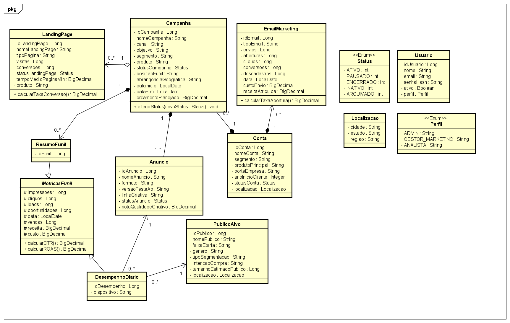
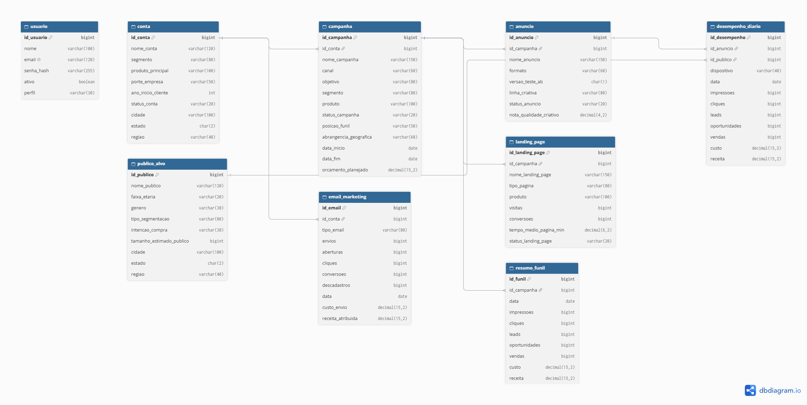
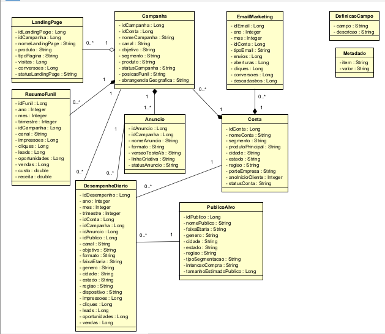

# Projeto Integrador Full Stack — Gestão e Análise de Marketing Digital

* **Instituição:** ESEG — Escola Superior de Engenharia e Gestão
* **Curso:** Engenharia de Computação — Programação Web (2º Semestre de 2026)
* **Estudante:** Eduardo Marques Fadini
* **Status do Projeto:** 1ª Entrega (Fases 1–4) ✅ | 2ª Entrega (Fases 5–8) ✅

---

## 1. Visão Geral do Projeto

Aplicação web desenvolvida em **Java com Spring Boot** para modernização de uma base de dados legada de marketing digital (`18_marketing_digital.xlsx`, composta por 31.314 registros distribuídos entre 2024 e 2025). O sistema elimina redundâncias estruturais através da normalização na **3ª Forma Normal (3FN)**, substitui colunas calculadas fixas por métodos de domínio dinâmicos com precisão `BigDecimal`, padroniza o controle de ciclo de vida das entidades via máquina de estados (`Status`) e implementa regras de negócio financeiras e temporais com persistência relacional real.

---

## 2. Tecnologias Utilizadas

* **Linguagem:** Java 21
* **Framework Backend:** Spring Boot 3.3.5 (`Spring Web / MVC`, `Spring Data JPA`, `Bean Validation`)
* **ORM / Persistência:** Hibernate / Jakarta Persistence (JPA)
* **Banco de Dados Relacional:** H2 Database (configurado em modo de persistência física em disco `./data/marketing_db`) e suporte a PostgreSQL
* **Template Engine:** Thymeleaf + Bootstrap 5
* **Controle de Versão e Build:** Git & Apache Maven

---

## 3. Arquitetura e Organização do Projeto (Fase 05)

O código-fonte segue a arquitetura em camadas no pacote base `br.edu.eseg.marketing`:

```text
meu-projeto-marketing/
├── docs/                                # Artefatos de modelagem, diagramas UML/DER e relatório técnico
│   ├── Relatorio_Tecnico_Entrega1.pdf
│   ├── diagrama-classes-uml.png
│   ├── modelo-relacional-der.png
│   ├── modelo-legado.png
│   └── modelagem.asta
├── sql/
│   └── schema.sql                       # Script DDL do Modelo Relacional Evoluído
├── src/
│   ├── main/
│   │   ├── java/br/edu/eseg/marketing/
│   │   │   ├── config/                  # DataInitializer (migração automática do .xlsx legado)
│   │   │   ├── controller/              # Controllers Spring MVC e GlobalExceptionHandler
│   │   │   ├── domain/                  # Entidades JPA, @MappedSuperclass, @Embeddable e Enums
│   │   │   ├── exception/               # Exceções de regra de negócio e recursos não encontrados
│   │   │   ├── repository/              # Interfaces Spring Data JPA com consultas customizadas
│   │   │   ├── service/                 # Regras de negócio, validações, transições e CRUD
│   │   │   └── MarketingDigitalApplication.java
│   │   └── resources/
│   │       ├── static/css/              # Folhas de estilo
│   │       ├── templates/               # Templates dinâmicos Thymeleaf
│   │       ├── 18_marketing_digital.xlsx # Base de dados legada para migração automatizada
│   │       └── application.properties   # Configuração da unidade de persistência e servidor
│   └── test/                            # Testes automatizados JUnit 5
├── .gitignore
├── pom.xml
└── README.md
```

---

## 4. Instruções de Instalação, Configuração e Execução

### 4.1. Pré-requisitos
* **JDK 21** instalado e configurado no `PATH`.
* **Maven 3.9+** (ou utilização do Maven embutido na IDE IntelliJ IDEA / VS Code).

### 4.2. Passo a Passo para Executar
1. Clone o repositório:
   ```bash
   git clone [https://github.com/SEU-USUARIO/projeto-integrador-marketing-digital.git](https://github.com/SEU-USUARIO/projeto-integrador-marketing-digital.git)
   cd projeto-integrador-marketing-digital
   ```
2. Execute a aplicação via Maven ou diretamente pela classe `MarketingDigitalApplication` na IDE:
   ```bash
   mvn spring-boot:run
   ```
3. **Migração Automática na Inicialização (`DataInitializer`):**
   * Na primeira execução, o sistema lê automaticamente o arquivo `src/main/resources/18_marketing_digital.xlsx`, higieniza os dados (convertendo datas seriais do Excel para `LocalDate` e unificando os status divergentes para o enum `Status`) e persiste os **31.314 registros** no banco de dados local (`./data/marketing_db`):
      * **40** Contas Anunciantes
      * **160** Campanhas
      * **560** Anúncios
      * **220** Públicos-Alvo
      * **120** Landing Pages
      * **1.473** Disparos de E-mail Marketing
      * **3.831** Resumos de Funil
      * **24.910** Registros de Desempenho Diário (normalizados na 3FN)
      * **3** Usuários padrão (`admin@eseg.edu.br`, `gestor@eseg.edu.br`, `analista@eseg.edu.br`)

### 4.3. Endereços de Acesso Local
* **Aplicação Web:** `http://localhost:8081`
* **Console do Banco de Dados (H2 Console):** `http://localhost:8081/h2-console`
   * **JDBC URL:** `jdbc:h2:file:./data/marketing_db`
   * **User Name:** `sa`
   * **Password:** *(deixar em branco)*

---

## 5. Entregas Técnicas — 2ª Entrega (Fases 5 a 8)

### Fase 06: Persistência com JPA e Mapeamento Objeto-Relacional
* **Herança (`@MappedSuperclass`):** Superclasse abstrata `MetricasFunil` centralizando `impressoes`, `cliques`, `leads`, `oportunidades`, `vendas`, `data`, `custo` e `receita`, herdada por `ResumoFunil` e `DesempenhoDiario`, com métodos dinâmicos `calcularCTR()` e `calcularROAS()`.
* **Composição (`@Embeddable` / `@Embedded`):** Value Object `Localizacao` (`cidade`, `estado`, `regiao`) embutido em `Conta` e `PublicoAlvo`.
* **Repositories JPA:** 9 interfaces `JpaRepository` com consultas `JOIN FETCH` otimizadas e funções de agregação (`COALESCE(SUM(custo), 0)`) para apuração financeira em tempo real.

### Fase 07: Regras de Negócio e Validações (`Service` & `Domain`)
1. **Máquina de Estados de `Status` (`Campanha.alterarStatus`):** Bloqueia transições inconsistentes — campanhas ou anúncios com status `ENCERRADO` ou `ARQUIVADO` não podem retornar para `ATIVO` ou `PAUSADO`. Alterar uma campanha para `PAUSADO` ou `ENCERRADO` sincroniza automaticamente o status dos anúncios vinculados.
2. **Controle de Estouro de Orçamento (Requisito Novo - RF05):** Calcula o custo acumulado da campanha e impede a criação ou ativação de novos anúncios caso o gasto atinja ou supere o `orcamentoPlanejado`.
3. **Consistência Temporal (RNF01):** Valida que `dataFim` nunca seja anterior a `dataInicio`.
4. **Integridade de Conta Anunciante:** Impede a criação/ativação de campanhas em contas com status `INATIVO` e bloqueia a inativação de contas que possuam campanhas em execução (`ATIVO`).
5. **Proteção de Exclusão:** Bloqueia a exclusão direta de campanhas com status `ATIVO`.

### Fase 08: Backend, Rotas HTTP e Tratamento de Erros (`Controller`)
* **`DashboardController` (`GET /`, `GET /dashboard`):** Consolida indicadores globais, total de campanhas com orçamento estourado e listagens recentes.
* **`CampanhaController` (`/campanhas`):** CRUD completo, visualização detalhada de funil/orçamento (`GET /{id}`), transição controlada de status (`POST /{id}/status`) e exclusão protegida (`POST /{id}/excluir`).
* **`AnuncioController` (`/anuncios`):** CRUD de criativos integrado à validação de orçamento e status da campanha.
* **`ContaController` (`/contas`):** Cadastro e edição de contas anunciantes com validação do componente `Localizacao`.
* **`GlobalExceptionHandler` (`@ControllerAdvice`):** Captura centralizada de `RegraNegocioException` e `RecursoNaoEncontradoException`, convertendo falhas de domínio em feedbacks amigáveis (`RedirectAttributes`) sem expor erros 500 ao usuário.

---

## 6. Modelagem e Documentação — 1ª Entrega (Fases 1 a 4)

Os artefatos completos de diagnóstico da base legada, matriz de rastreabilidade e modelagem estão disponíveis no diretório `docs/` e `sql/`:

* 📄 **[Relatório Técnico Completo](docs/Relatorio_Tecnico_Entrega1.pdf)**
* 🗄️ **[Script SQL DDL Evoluído](sql/schema.sql)**

### Diagrama de Classes UML (Fase 03)


### Modelo Relacional Evoluído — DER (Fase 04)


### Modelo Legado Original (Fase 02)
